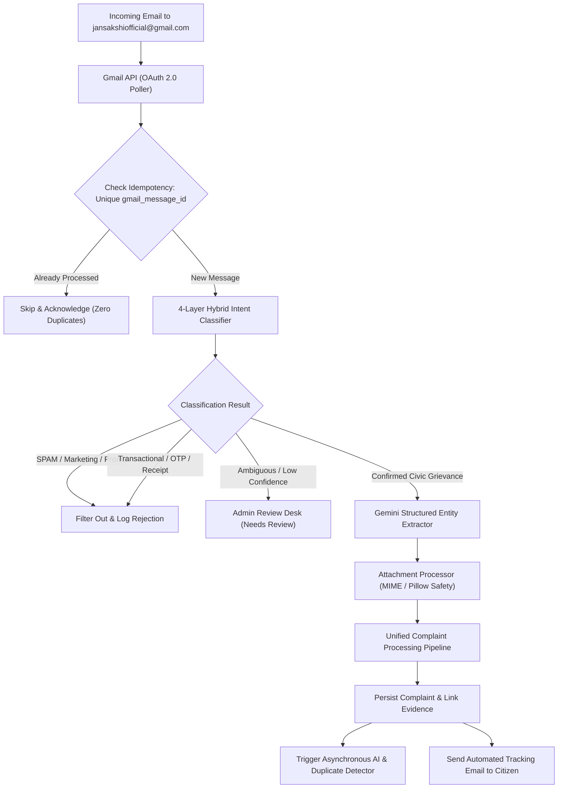
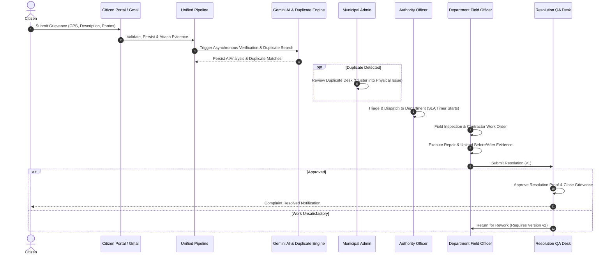
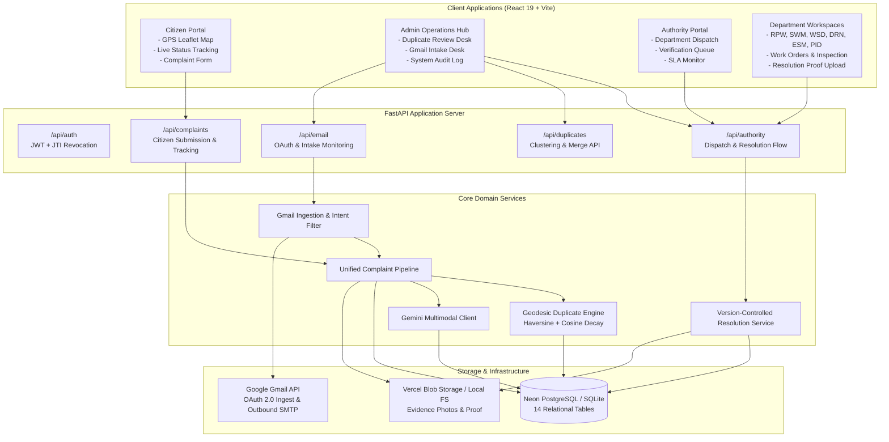
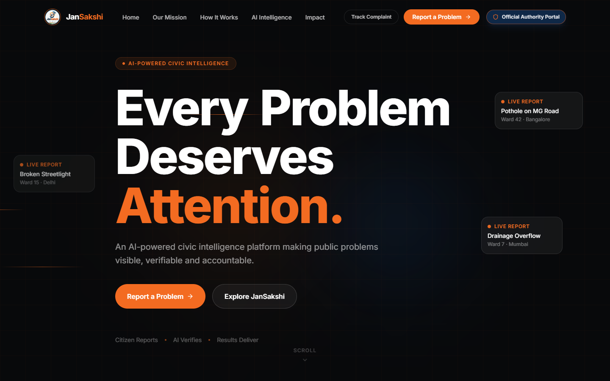
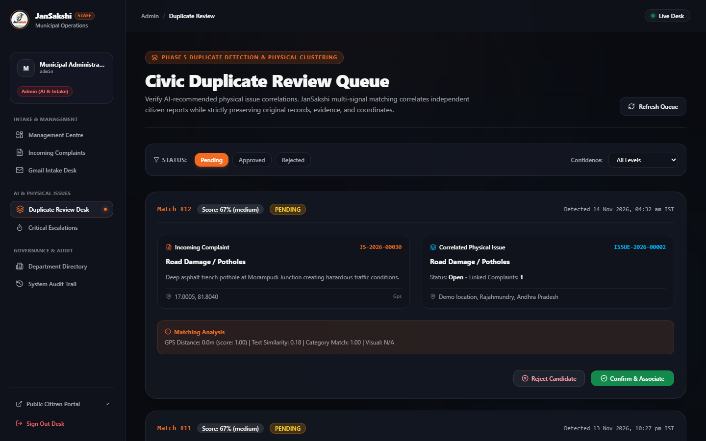

# JanSakshi (जन साक्षी) — The People's Witness

<div align="center">
  

  ### AI-Powered Civic Grievance Verification & Municipal Accountability Platform
  **Citizen Reports. Multimodal AI Verifies. Traceable Workflows Deliver Accountability.**

  [](https://fastapi.tiangolo.com/)
  [](https://react.dev/)
  [](https://tailwindcss.com/)
  [](https://ai.google.dev/)
  [](https://neon.tech/)
  [](https://leafletjs.com/)
</div>

---

## Table of Contents

1. [Executive Overview and Problem Statement](#executive-overview-and-problem-statement)
2. [Why JanSakshi Stands Out](#why-jansakshi-stands-out)
3. [Intelligent Geodesic Duplicate Detection Engine](#intelligent-geodesic-duplicate-detection-engine)
   - [Haversine Distance Formulation](#a-geographical-distance-calculation-haversine)
   - [Smooth Cosine Decay Similarity Scoring](#b-cosine-based-distance-similarity-scoring)
   - [Multimodal Signal Matrix and Fusion](#c-multi-factor-signal-matrix-and-dynamic-renormalization)
4. [Gmail AI Grievance Desk Pipeline](#gmail-ai-grievance-desk-pipeline)
   - [4-Layer Hybrid Intent Classification](#4-layer-hybrid-intent-classification)
   - [Idempotent Ingestion and Advisory Locks](#idempotency-and-concurrency-safeguards)
   - [Gemini Structured Extraction and Auto-Acknowledgment](#gemini-extraction-and-citizen-acknowledgment)
5. [Multimodal Vision and AI Inspection](#multimodal-vision-and-ai-inspection)
6. [End-to-End Complaint Lifecycle](#end-to-end-complaint-lifecycle)
7. [System Architecture](#system-architecture)
8. [Role-Based Access Control (RBAC)](#role-based-access-control-rbac)
9. [Technology Stack](#technology-stack)
10. [Visual Tour and System Screenshots](#visual-tour-and-system-screenshots)
11. [Repository Structure](#repository-structure)
12. [Installation and Local Setup](#installation-and-local-setup)
13. [Automated Verification Test Suite](#automated-verification-test-suite)
14. [Future Roadmap](#future-roadmap)
15. [Project Summary and Links](#project-summary-and-links)

---

## Executive Overview and Problem Statement

Urban Local Bodies (ULBs) across India manage thousands of citizen grievances weekly. However, legacy municipal systems collapse under recurring operational bottlenecks:
- **Duplicate Report Storms:** A single severe pothole, overflowing garbage vat, or broken streetlight triggers 30–50 individual complaint submissions from different citizens across multiple days, fragmenting field responses and creating artificial backlogs.
- **Spam & Non-Civic Pollution:** Unfiltered email intake systems waste officer work hours manually separating promotional spam, newsletter feeds, and non-actionable complaints from genuine civic emergencies.
- **Superficial "Paper Closures":** Field contractors frequently mark complaints "Resolved" without verifiable, timestamped photographic proof or quality checks.
- **Channel Silos:** Grievances submitted through web forms and official email inboxes operate in silos with no unified duplicate grouping, audit tracking, or status reconciliation.

**JanSakshi** transforms civic grievance handling from an unverified complaint inbox into an **intelligent, multimodal verification and operational dispatch engine**. JanSakshi validates incoming complaints using multimodal Google Gemini vision, groups redundant reports under unified **Physical Issues** using high-precision geodesic spatial and perceptual algorithms, and provides role-based municipal workspaces with strict accountability workflows.

---

## Why JanSakshi Stands Out

| # | Core Innovation | Traditional Civic Portals | JanSakshi Platform |
|:---:|:---|:---|:---|
| **1** | **Duplicate Detection** | Exact address string match or crude bounding boxes | **Haversine distance + Smooth Cosine Decay** combined with lexical and visual perceptual hashing |
| **2** | **Signal Fusion** | Single-signal (text or location only) | **Dynamically normalized multi-signal fusion** (GPS: 35%, Text: 30%, Image: 25%, Category: 10%) |
| **3** | **Email Ingestion** | Unmonitored inbox or spam-vulnerable ticket creator | **Gmail API OAuth 2.0 with 4-Layer Intent Classification**, Gemini entity extraction, and instant tracking delivery |
| **4** | **Visual Verification** | Static image upload without analysis | **Gemini Multimodal Vision** evaluating evidence relevance, visibility, blur, and severity |
| **5** | **Field Accountability** | Unverified status dropdown update | **Multi-version resolution submissions** (`v1`, `v2`) with before/after photo comparison and sign-off review |
| **6** | **Session Security** | Permanent passwords or long-lived static tokens | **Short-lived access tokens (30 min)** backed by cryptographic single-use rotating refresh tokens and JTI revocation |
| **7** | **Traceability** | Black-box state changes | **Chronological audit event history** tracking transitions from intake to inspection, work order, and approval |

---

## Intelligent Geodesic Duplicate Detection Engine

> **Main Technical Highlight:** JanSakshi never relies solely on complaint text or street names to identify duplicates. Instead, it deploys a mathematical geodesic proximity pipeline coupled with cosine-decay similarity scoring.

```
+--------------------------------------------------------------------------------------------------+
|                                    CANDIDATE RETRIEVAL                                           |
|       Incoming Coordinates (lat, lon)  --->  Coarse Bounding Box Filter (Indexed Coordinates)     |
|                                       --->  Candidate Search Radius (R_search = 150m)            |
+--------------------------------------------------------------------------------------------------+
                                                  |
                                                  v
+--------------------------------------------------------------------------------------------------+
|                                   MULTI-SIGNAL SCORING MATRIX                                    |
|                                                                                                  |
|   1. Geodesic Proximity (35%)     2. Lexical Semantics (30%)     3. Perceptual Image Hash (25%)  |
|      - Haversine Distance (m)        - TF-IDF Cosine (45%)          - Difference Hash (dHash)    |
|      - Cosine Decay S-Curve          - Token Overlap (35%)          - Average Hash (aHash)       |
|      - Tolerance: 5m to 100m         - Token Jaccard (20%)          - SSRF-Safe Pinned Fetcher   |
|                                                                                                  |
|   4. Category Compatibility (10%)                                                                |
|      - Exact Match (1.0), Related Cluster (0.40 - 0.55), Incompatible (0.0)                     |
+--------------------------------------------------------------------------------------------------+
                                                  |
                                                  v
+--------------------------------------------------------------------------------------------------+
|                            DYNAMIC RENORMALIZATION & DECISION GATE                               |
|                     Composite Score = Sum(w_k * s_k) / Sum(w_k) [for available k]               |
|            - High Confidence (>= 0.85)     - Medium (0.65 - 0.84)     - Low (< 0.65)             |
|                                                  |                                               |
|                    HUMAN-IN-THE-LOOP: Authority Officer Confirms & Merges                        |
+--------------------------------------------------------------------------------------------------+
```

### A. Geographical Distance Calculation (Haversine)

Given two GPS coordinate pairs $(\text{lat}_1, \text{lon}_1)$ and $(\text{lat}_2, \text{lon}_2)$, spherical coordinates are converted into radians:

$$\phi_1 = \operatorname{radians}(\text{lat}_1), \quad \phi_2 = \operatorname{radians}(\text{lat}_2)$$

$$\Delta\phi = \operatorname{radians}(\text{lat}_2 - \text{lat}_1), \quad \Delta\lambda = \operatorname{radians}(\text{lon}_2 - \text{lon}_1)$$

The intermediate square half-chord length $a$ is calculated as:

$$a = \sin^2\left(\frac{\Delta\phi}{2}\right) + \cos(\phi_1)\cos(\phi_2)\sin^2\left(\frac{\Delta\lambda}{2}\right)$$

To guard against floating-point imprecision exceeding unity, $a$ is clamped to $[0.0, 1.0]$. The angular distance in radians $c$ is computed using the two-argument arctangent:

$$c = 2 \cdot \operatorname{atan2}\left(\sqrt{a}, \sqrt{1 - a}\right)$$

The geodesic surface distance $d$ in metres is:

$$d = R \cdot c$$

Where:
- $\phi_1, \phi_2$: Geodetic latitudes in radians
- $\lambda_1, \lambda_2$: Geodetic longitudes in radians
- $R$: Mean radius of Earth $= 6{,}371{,}000.0\text{ metres}$ (`EARTH_RADIUS_METERS`)
- $d$: True physical surface distance across the Earth's curvature in metres

---

### B. Cosine-Based Distance Similarity Scoring

Linear distance decay penalizes close coordinates unrealistically and creates harsh boundaries. JanSakshi introduces a **smooth S-curve cosine decay function** based on physical municipal realities:

1. **Zero-Tolerance Radius ($d \le 5\text{ m}$):** Due to consumer smartphone GPS drift, two reports taken within 5 metres of each other are physically co-located. Score = $1.0$.
2. **Maximum Proximity Cutoff ($d \ge 100\text{ m}$):** Beyond 100 metres on an urban grid, civic issues are treated as physically distinct issues. Score = $0.0$.
3. **Smooth Transition ($5\text{ m} < d < 100\text{ m}$):** The score decays along a cosine curve, providing a gradual transition.

#### Piecewise Mathematical Expression

$$S_{\text{GPS}}(d) = \begin{cases}
1.0 & \text{if } d \le 5\text{ m} \\
0.0 & \text{if } d \ge 100\text{ m} \\
0.5 \times \left(1 + \cos\left(\pi \times \frac{d - 5}{95}\right)\right) & \text{if } 5\text{ m} < d < 100\text{ m}
\end{cases}$$

Where the normalized distance fraction is:

$$\text{fraction} = \frac{d - d_{\min}}{d_{\max} - d_{\min}} = \frac{d - 5.0}{100.0 - 5.0} = \frac{d - 5.0}{95.0}$$

```
Similarity Score
   1.0 |========\
       |         \
   0.8 |          \
       |           \
   0.5 |            \----------- (Inflection point at 52.5m)
       |                         \
   0.2 |                          \
       |                           \
   0.0 |____________________________\===========
       0m   5m       25m     50m    75m   100m   125m  (Distance d)
```

#### Empirical Sampling Table

| Distance $d$ (metres) | Relative Municipal Vicinity | Computed Similarity $S_{\text{GPS}}$ | Physical Interpretation |
|:---:|:---|:---:|:---|
| **$0.0\text{ m}$** | Exact coordinate overlap | **$1.0000$** | Identical GPS pin |
| **$5.0\text{ m}$** | Handheld GPS accuracy envelope | **$1.0000$** | Zero-tolerance threshold |
| **$15.0\text{ m}$** | Same street corner / opposite sidewalk | **$0.9730$** | Extremely high confidence match |
| **$30.0\text{ m}$** | Two buildings away on the same lane | **$0.8387$** | Strong candidate proximity |
| **$52.5\text{ m}$** | Half-block separation (midpoint) | **$0.5000$** | Symmetric cosine inflection point |
| **$75.0\text{ m}$** | End of street block | **$0.1464$** | Weak candidate proximity |
| **$95.0\text{ m}$** | Adjacent cross street | **$0.0068$** | Near-zero proximity |
| **$\ge 100.0\text{ m}$** | Different neighborhood segment | **$0.0000$** | Absolute spatial cutoff |

---

### C. Multi-Factor Signal Matrix and Dynamic Renormalization

Relying solely on GPS produces false positives when two completely different problems occur at the same intersection (e.g., an open manhole next to an uncollected garbage pile). JanSakshi couples GPS proximity with three independent signals:

#### 1. Text Similarity ($w = 0.30$)
Combines lexical normalization, civic domain stemming, and three weighted sub-metrics:
- **Unigram TF Cosine Similarity ($45\%$):** Measures term vector orientation after removing civic stopwords.
- **Token Overlap Coefficient ($35\%$):** Measures containment: $|S_1 \cap S_2| / \min(|S_1|, |S_2|)$, ensuring brief reports ("pothole here") match detailed descriptions.
- **Token Jaccard Coefficient ($20\%$):** Evaluates overall vocabulary intersection: $|S_1 \cap S_2| / |S_1 \cup S_2|$.

#### 2. Perceptual Image Similarity ($w = 0.25$)
To detect duplicate photos across varying lighting conditions, camera angles, and mobile resolutions:
- **Difference Hash (dHash):** Resizes images to $9 \times 8$ grayscale and computes adjacent pixel gradients (64-bit integer).
- **Average Hash (aHash):** Resizes images to $8 \times 8$ grayscale and compares each pixel to mean luminance (64-bit integer).
- **Hamming Distance Scaling:** Measures differing bits ($d_H$). Normalizes via $\max(0.0, 1.0 - d_H/32.0)$.
- **Composite Image Score:** $0.60 \times S_{\text{dHash}} + 0.40 \times S_{\text{aHash}}$.
- **SSRF Hardening:** Images fetched from remote Vercel Blob storage pass through `PinnedHTTPSConnection`, enforcing DNS pre-resolution to public IPs and eliminating TOCTOU DNS rebinding.

#### 3. Category Compatibility ($w = 0.10$)
Evaluates cross-category semantic compatibility:
- Exact category match: $1.0$
- Compatible clusters (e.g., *Road Damage* $\leftrightarrow$ *Damaged Public Infrastructure*): $0.55$
- Related water/drainage issues (*Drainage Overflow* $\leftrightarrow$ *Water Leakage*): $0.50$
- Conflicting categories (e.g., *Streetlights* vs *Garbage*): $0.00$

#### Dynamic Missing Signal Renormalization

When photographic evidence is omitted by a citizen, JanSakshi **never penalizes the score with zero**. Instead, it dynamically renormalizes remaining weights:

$$\text{Composite Score} = \frac{\sum_{k \in \mathcal{A}} w_k \cdot s_k}{\sum_{k \in \mathcal{A}} w_k}$$

Where $\mathcal{A}$ is the set of available signals ($s_k \neq \text{None}$). If $\sum_{k \in \mathcal{A}} w_k < 0.35$ (`MIN_REQUIRED_WEIGHT`), the engine fails safe and flags `insufficient_evidence`.

#### Decision Thresholds & Safeguards
- **High Confidence ($\ge 0.85$):** Candidate duplicate flagged for primary administrative merge.
- **Medium Confidence ($0.65 - 0.84$):** Potential match recommended for manual authority inspection.
- **Low Confidence ($< 0.65$):** Unlikely duplicate; treated as distinct physical issue.
- **Human-in-the-Loop Safeguard:** JanSakshi **never automatically merges or discards complaints**. Duplicate clustering recommendations are surfaced in the *Duplicate Review Desk* where authorized officers execute the merge with an audit trail.

---

## Gmail AI Grievance Desk Pipeline

Citizens without access to specialized web apps submit grievances directly via email. JanSakshi provides a production-grade automated Gmail ingestion desk powered by Google Gemini and OAuth 2.0.



### 4-Layer Hybrid Intent Classification
To protect municipal servers from email spam and newsletter dumps, every email passes through four filters:
1. **Layer 1 — Header & System Signature Filter:** Evaluates RFC-2822 headers, detecting auto-responders, mail daemons, and `List-Unsubscribe` headers.
2. **Layer 2 — Deterministic Regex Filter:** Matches transactional keywords (OTPs, bank transfers, e-commerce orders, password resets).
3. **Layer 3 — Gemini LLM Intent Analyzer:** Analyzes unstructured multilingual text to categorize intent into `civic_complaint`, `spam`, `transactional`, or `general_query`.
4. **Layer 4 — Human Review Desk Routing:** Ambiguous scores ($0.45 - 0.70$) are routed to the *Gmail Desk* queue in the Admin dashboard, preventing false drops.

### Idempotency and Concurrency Safeguards
- **`gmail_message_id` Enforcement:** The database applies a unique constraint on `email_messages.gmail_message_id`. The unique message ID prevents duplicate email records for the same Gmail message; the processor checks existing records before retrying or continuing processing.
- **PostgreSQL Advisory Locks:** `GmailSyncLock` acquires a dedicated session-level lock (`ADVISORY_LOCK_ID = 987654321`) ensuring multiple background workers never poll or process the inbox concurrently.

### Gemini Extraction and Citizen Acknowledgment
- **Entity Extraction:** Gemini parses unformatted emails into structured data: category, concise title, full description, landmarks, extracted location strings, and urgency level.
- **Automated Citizen Tracking Email:** Once a valid complaint is persisted, `AcknowledgementService` immediately delivers a responsive, branded HTML email containing the assigned Complaint ID (`JS-2026-XXXXX`), municipal department SLA deadline, and a direct tracking link.

---

## Multimodal Vision and AI Inspection

JanSakshi integrates the Google Gen AI SDK (`google-genai` v3.0+) to inspect civic evidence photos before dispatch:

```
[ Citizen Photo Evidence ] ───> [ Safety Verification & PIL Preprocessing ]
                                         │
                                         ▼
                            [ Google Gemini Multimodal ]
                                         │
        ┌────────────────────────────────┴────────────────────────────────┐
        ▼                                ▼                                ▼
[ Category Validation ]         [ Severity & Safety ]           [ Image Quality Audit ]
- Predicted taxonomy            - Low / Medium / High           - Clarity score (0-100)
- Confidence (0.0 - 1.0)        - Critical safety flags         - Visibility score (0-100)
- Mismatch detection            - Structural damage notes       - Blur / darkness flags
```

- **Damage Verification:** Confirms that uploaded imagery matches the claimed complaint category.
- **Image Quality Scoring:** Checks for blur, obstruction, darkness, or tampering, setting `additional_evidence_required = True` if photos are unreadable.
- **Automated Severity Recommendation:** Suggests priority levels (`low`, `medium`, `high`, `critical`) to help dispatchers allocate resources to life-threatening hazards first.

---

## End-to-End Complaint Lifecycle



---

## System Architecture

JanSakshi separates citizen ingestion from administrative workflows through a modular architecture:



---

## Role-Based Access Control (RBAC)

JanSakshi enforces strict role segregation across all administrative routes:

| Role Identifier | Human-Facing Role | Scope of Operational Authority |
|:---|:---|:---|
| **`admin`** | **Municipal Administrator** | Complete system oversight. Manages the *Duplicate Review Desk* (merging duplicate complaints into Physical Issues), the *Gmail Intake Desk* (resolving ambiguous emails), viewing global audit event streams, and accessing all department workspaces. |
| **`authority_officer`** | **Civic Verification Officer** | First-line municipal verification. Reviews incoming complaints, validates urgency, dispatches complaints to municipal departments, sets SLA targets, or requests additional citizen evidence. |
| **`department_officer`** | **Department Field Officer** | Department-specific execution. Scoped to assigned departments (e.g., *Roads & Public Works* or authorized multi-department portfolios). Issues contractor work orders, schedules field inspections, uploads before/after repair evidence, and submits versioned resolutions. |

> *Note: In accordance with municipal governance principles, there is no generic super-admin or unvetted bypass role.*

### Municipal Department Taxonomies & SLAs

1. **RPW** — Roads & Public Works (Potholes, asphalt damage, footpaths, road barriers; SLA: 7 days)
2. **SWM** — Sanitation & Waste Management (Garbage dumps, bin overflows, street sweeping; SLA: 3 days)
3. **WSD** — Water Supply & Sewerage (Pipeline leaks, contamination, drinking water shortage; SLA: 5 days)
4. **DRN** — Storm Water Drainage (Clogged drains, open canals, monsoon waterlogging; SLA: 4 days)
5. **ESM** — Electrical & Street Lighting (Broken streetlights, dangling cables, unlit corridors; SLA: 2 days)
6. **PID** — Public Infrastructure & Parks (Damaged parks, open manholes, bus stops; SLA: 10 days)

---

## Technology Stack

Verified against repository dependencies:

```
+---------------------------------------------------------------------------------------------------+
| FRONTEND                  BACKEND                     DATABASE & STORAGE          AI & EXTERNAL   |
| React 19.3                Python 3.12                 Neon PostgreSQL (Prod)      Google GenAI v3 |
| Vite 8.3                  FastAPI 0.115               SQLite 3 (Local Zero-Config) Gemini 3.8/2.5 |
| Tailwind CSS v4           SQLAlchemy 2.1              Vercel Blob Storage         Gmail API v2    |
| Leaflet & React-Leaflet   Uvicorn 0.32                Pillow 13.0 (Image I/O)     OpenLocationCode|
| Lucide React              PyJWT & Bcrypt              psycopg 3 / psycopg2-binary Framer Motion   |
+---------------------------------------------------------------------------------------------------+
```

| Layer | Technology | Primary Functionality |
|:---|:---|:---|
| **Frontend Framework** | React 19.3.1 + Vite 8.3.6 | Component UI rendering, hot reloading, production bundling |
| **UI Styling & Animation** | Tailwind CSS v4.3.5, Framer Motion, GSAP | Responsive design, glassmorphism dark theme, smooth micro-interactions |
| **Geospatial & Mapping** | Leaflet 1.9.4, React-Leaflet 5.0.0 | Interactive citizen GPS pin placement, reverse geocoding display |
| **Backend Framework** | FastAPI 0.115.5 + Uvicorn 0.32.1 | Asynchronous REST API, automated OpenAPI/Swagger generation |
| **ORM & Data Layer** | SQLAlchemy 2.1.8 | Database models, connection pooling, migrations, advisory locks |
| **Relational Database** | Neon PostgreSQL (Serverless) / SQLite | Production ACID persistence across 14 relational tables |
| **AI Vision & NLP** | Google Gen AI SDK 3.0.0 (`google-genai`) | Gemini Multimodal image verification, email entity extraction |
| **Image Analysis** | Pillow 13.0.0 | dHash, aHash perceptual image hashing, safe format conversion |
| **Email Subsystem** | Google API Client (`google-api-python-client`) | Gmail OAuth 2.0, inbox monitoring, citizen auto-acknowledgments |
| **Security & Auth** | `bcrypt` 5.0.0, `PyJWT` 2.15.1, `cryptography` | Password hashing, short-lived JWT access tokens, rotating refresh tokens |
| **Geocoding Standards** | `openlocationcode` 1.0.1 | Plus Code resolution for high-density urban areas |

---

## Visual Tour and System Screenshots

Authentic screenshots captured from the JanSakshi application:

<div align="center">
  <p><b>Figure 1: Citizen Grievance Portal — Leaflet Pin-Drop & Category Taxonomy</b></p>
  
</div>

<br />

<div align="center">
  <p><b>Figure 2: Municipal Operations Centre — Administrative Overview</b></p>
  
</div>

<br />

<div align="center">
  <p><b>Figure 3: Intelligent Duplicate Review Desk — Multi-Signal Clustering & Verification</b></p>
  
</div>

<br />

<div align="center">
  <p><b>Figure 4: Automated Gmail Grievance Desk — 4-Layer Intent Classification & Status</b></p>
  
</div>

<br />

<div align="center">
  <p><b>Figure 5: Department Field Workspace & Contractor Work Order Dispatch</b></p>
  
</div>

---

## Repository Structure

```
JanSakshi/
├── backend/
│   ├── app/
│   │   ├── core/                      # JWT security, bcrypt hashing, session policy, config
│   │   ├── database.py                # Engine initialization, pool resilience, advisory locks
│   │   ├── main.py                    # FastAPI entrypoint, middleware, router mounts
│   │   ├── models/                    # 14 SQLAlchemy ORM models:
│   │   │   ├── complaint.py           # Complaint, PhysicalIssue, Evidence, AIAnalysis, Events
│   │   │   ├── authority.py           # User, Department, RevokedToken
│   │   │   ├── email_message.py       # EmailMessage, OAuthToken, OAuthState
│   │   │   └── resolution.py          # ResolutionSubmission, ResolutionEvidenceAnalysis
│   │   ├── pipeline/                  # Unified complaint ingestion pipeline & input validators
│   │   ├── repositories/              # Database repositories & audit event emitters
│   │   ├── routes/                    # REST API endpoints:
│   │   │   ├── auth_routes.py         # Login, refresh token rotation, logout revocation
│   │   │   ├── complaints.py          # Citizen submission, public tracking
│   │   │   ├── duplicates.py          # Candidate retrieval, duplicate merge API
│   │   │   ├── email_routes.py        # Gmail OAuth, manual sync, review desk
│   │   │   └── authority_routes.py    # Dispatch, work orders, resolution approvals
│   │   ├── schemas.py                 # Pydantic v2 validation contracts
│   │   ├── services/
│   │   │   ├── ai/                    # Gemini client, prompt templates, response parsers
│   │   │   ├── duplicate_detection/   # Haversine, cosine decay, dHash/aHash, scoring
│   │   │   ├── email/                 # Gmail OAuth, inbox monitor, 4-layer intent classifier
│   │   │   └── storage_service.py     # SSRF-hardened storage & Vercel Blob integrations
│   │   └── tasks/                     # Asynchronous background tasks
│   ├── requirements.txt               # Backend Python dependencies
│   ├── .env.example                   # Template environment configuration
│   └── test_*.py                      # Automated test suites
├── frontend/
│   ├── public/                        # Static assets, hero imagery, category icons
│   ├── src/
│   │   ├── components/                # Reusable UI cards, maps, modals, navigation
│   │   ├── context/                   # AuthContext (silent refresh, token management)
│   │   ├── pages/                     # Application pages:
│   │   │   ├── CitizenPortal.jsx      # Grievance reporting form & map pin-drop
│   │   │   ├── ComplaintTrackPage.jsx # Live public status & timeline
│   │   │   ├── AuthorityLoginPage.jsx # Secure staff authentication
│   │   │   ├── AdminDashboard.jsx     # Master admin desk & system metrics
│   │   │   ├── DuplicateReviewPage.jsx# Interactive duplicate cluster review
│   │   │   ├── GmailDeskPage.jsx      # Email grievance queue & spam review
│   │   │   └── DepartmentWorkspace.jsx# Field inspections, work orders, proof review
│   │   └── App.jsx                    # Routing configuration
│   ├── package.json                   # Frontend dependencies
│   └── vite.config.js                 # Vite build settings
├── Screenshots/                       # Authentic UI captures & architectural diagrams
├── README.md                          # Comprehensive project documentation
└── vercel.json                        # Monorepo build and deployment configuration
```

---

## Installation and Local Setup

### Prerequisites
- **Python:** 3.11 or 3.12
- **Node.js:** v18.0.0+ (npm v9+)
- **Git**

---

### Step 1: Clone the Repository
```bash
git clone https://github.com/tejeswardoolla/JanSakshi.git
cd JanSakshi
```

---

### Step 2: Backend Setup
```bash
# Navigate to backend directory
cd backend

# Create virtual environment
python -m venv venv

# Activate virtual environment
# Windows (PowerShell):
.\venv\Scripts\Activate.ps1
# Linux / macOS:
source venv/bin/activate

# Install dependencies
pip install -r requirements.txt

# Create local environment file from template
# Windows:
copy .env.example .env
# Linux / macOS:
cp .env.example .env

# Start FastAPI development server
python -m uvicorn app.main:app --host 127.0.0.1 --port 8000 --reload
```

- **Backend API:** `http://127.0.0.1:8000`
- **Interactive Swagger Docs:** `http://127.0.0.1:8000/api/docs`
- **OpenAPI Specification:** `http://127.0.0.1:8000/openapi.json`
- **Health Check Endpoint:** `http://127.0.0.1:8000/api/health`

---

### Step 3: Frontend Setup
In a new terminal window:
```bash
# Navigate to frontend directory
cd frontend

# Install Node dependencies
npm install

# Start Vite development server
npm run dev
```

- **Citizen Application:** `http://localhost:5173`
- **Authority Login:** `http://localhost:5173/authority/login`

---

### Step 4: Environment Variables Template (`backend/.env`)

JanSakshi ships with an uncommitted `.env.example`. Key configuration options:

```ini
# Application Environment
APP_ENV=development
PORT=8000
ALLOWED_ORIGINS=http://localhost:5173,http://localhost:3000

# Database Configuration (Defaults to local SQLite if omitted)
DATABASE_URL=sqlite:///./jansakshi.db

# Authentication Security
JWT_SECRET_KEY=your-secure-jwt-secret-key-min-32-chars
ACCESS_TOKEN_EXPIRE_MINUTES=30
REFRESH_TOKEN_EXPIRE_DAYS=7

# Google Gemini Multimodal Vision API
GEMINI_API_KEY=your_gemini_api_key_from_ai_studio
GEMINI_MODEL=gemini-3.8-flash
AI_ANALYSIS_ENABLED=true

# Google Gmail API Grievance Integration (Optional in local dev)
GMAIL_ENABLED=false
GMAIL_INBOX_ADDRESS=jansakshiofficial@gmail.com
GMAIL_CLIENT_ID=your_oauth_client_id.apps.googleusercontent.com
GMAIL_CLIENT_SECRET=your_oauth_client_secret
GMAIL_REDIRECT_URI=http://localhost:8000/api/email/oauth/callback
```

---

## Automated Verification Test Suite

JanSakshi contains automated regression and verification test suites covering RBAC, security token rotation, duplicate detection math, and Gmail intent filtering:

```bash
cd backend

# 1. Master System Audit (Verifies RBAC, DB constraints, AI fallback)
python test_phase9_master_audit.py

# 2. Concurrency, Advisory Locks & Gmail Idempotency Test
python test_final_security_and_gmail_verification.py

# 3. Department Inspection & Contractor Work Order Workflow
python test_department_inspection_work_orders.py

# 4. Gmail Desk Intent Classification & Filter Audit
python test_email_desk_filters.py

# 5. Geodesic Duplicate Detection & Cosine Decay Regression
python test_judge_demo_access.py
```

---

## Future Roadmap

The following capabilities represent planned extensions to JanSakshi:

- **WhatsApp Grievance Integration:** Ingesting complaints, location pins, and voice notes via the Meta WhatsApp Business API.
- **Multilingual Voice Intake:** IVR phone hotlines with speech-to-text integration for citizens without internet or smartphone access.
- **Bhashini Indic Language Models:** Real-time translation supporting all 22 official Indian languages.
- **Offline Field Inspector PWA:** Progressive Web App with offline SQLite synchronization for field officers in low-connectivity areas.
- **Predictive Infrastructure Analytics:** Geospatial clustering to forecast road deterioration and recurring waterlogging before monsoon seasons.

---

## Project Summary and Links

JanSakshi bridges the gap between citizens reporting civic issues and urban authorities resolving them. By pairing **rigorous geodesic mathematics** with **multimodal AI vision**, **automated email classification**, and **role-based municipal accountability**, JanSakshi transforms chaotic civic complaint handling into a transparent, efficient municipal service.

- **GitHub Repository:** [https://github.com/tejeswardoolla/JanSakshi](https://github.com/tejeswardoolla/JanSakshi)
- **Live Demo / Deployment:** [https://jansakshi-umber.vercel.app](https://jansakshi-umber.vercel.app)
- **API Documentation:** [https://jansakshi-umber.vercel.app/api/docs](https://jansakshi-umber.vercel.app/api/docs)
